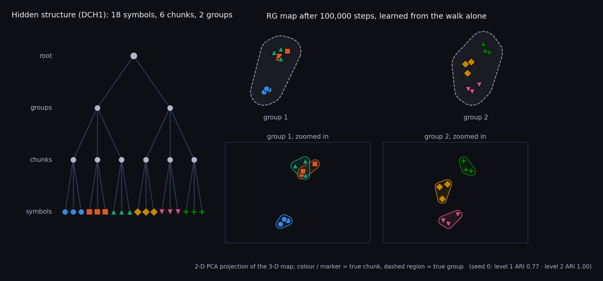
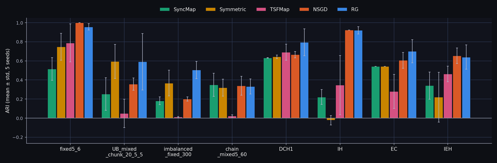
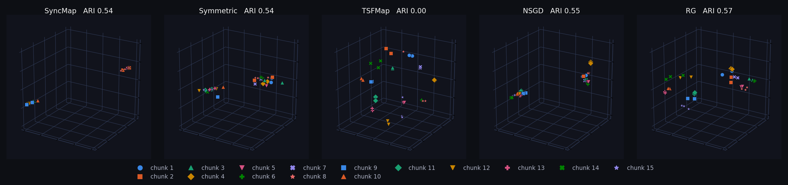
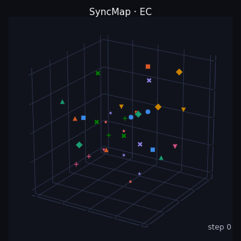
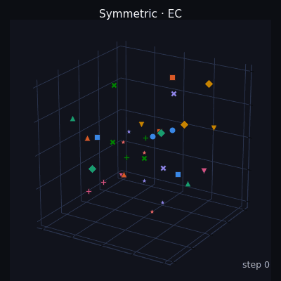
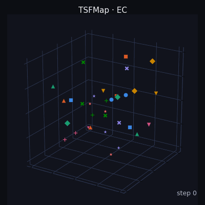
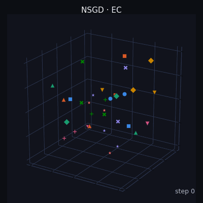
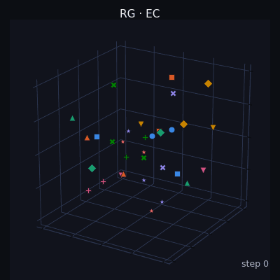

# SyncMapRGCI

SyncMapRGCI is a research project towards self-organizing causal inference: a system that, without labels, discovers the hierarchical chunk structure hidden in a sequence and then infers the causal relations between those chunks. The long-term target is visual event sequences (research theme: *Visual Causal Inference through Hierarchical Chunking via Self-Organizing Dynamics*). It builds on SyncMap and SyncMapX from the Elrion project of the Laboratory of Intelligent Systems (LIS). This is my personal research and study vault, started in October 2025.

The project has two parts:

- **RG, Recursive Grouping (implemented).** Hierarchical chunking inside one geometric space. The same self-organizing kernel is applied again to the tokens produced by the level below, at a larger natural scale (x3.16 per level), so chunks and groups of chunks appear as nested clusters of one map.
- **CI, Causal Inference (early experiments).** Directed relations: directed transition statistics, edge recovery on synthetic DAGs, line-graph / edge-token representations.

Combining the two, causal relations between the chunks RG discovers, exists only as a rough prototype and is not part of this repository. All current experiments use synthetic graph-walk symbol sequences: a random walk over a `.dot` graph produces the input stream, and each model has to recover the graph's chunks (flat) or its nested chunk levels (hierarchy). Labels are used only for scoring.



*Left: the hidden structure that generates the walk. Right: RG's map after 100,000 steps; the two groups are far apart, and zooming into each group shows its chunks as smaller clusters.*

## Algorithms

Main research lines:

- `NSGD` (`nsgd`): first-order SyncMap dynamics. Exponentially weighted co-activity statistics define a thresholded k-nearest-neighbour relation graph; positions move by relation attraction and activity-dependent displacement, with per-point plasticity and bounded steps. It is the baseline used by the historical reports. File: `syncmap/SyncMapX_NSGD.py`.
- `NS` (`ns`): the hierarchy-capable first-order kernel that evolved from NSGD. It runs standalone and is the per-level engine of RG; its behaviour is no longer identical to NSGD. File: `syncmap/SyncMapNS.py`.
- `RG` (`rg`): recursive hierarchical extension built on `SyncMapNS`. Level 0 learns the raw symbols; each higher level receives tokens produced by unsupervised coarse-graining of the level below, with distance, update cadence and statistics memory growing geometrically across levels. Main forces: primitive contrastive force, transition-graph spring, local obstacle repulsion and bounded macro feedback. File: `syncmap/SyncMapRG.py`.
- `CI` (`ci`): directed-transition baseline that runs independently from RG. `syncmap/SyncMapCI.py` provides directed transition statistics, edge-recovery evaluation, asymmetric node features and line-graph / edge-token representations; `syncmap/SyncMapX_CI.py` clusters prototype embeddings built on them. It is a research scaffold, not a completed causal-inference method.

Comparison baselines:

- `SyncMap` (`syncmap`): original SyncMap with a constant learning rate and DBSCAN readout. File: `syncmap/SyncMap.py`.
- `Symmetric` (`symmetric`): Symmetrical SyncMap with memory window, symmetric positive/negative sampling and moving-average readout. File: `syncmap/SyncMapX_Symmetric.py`.
- `TSF` (`tsf`): TSFMap-style centroid dynamics with post-hoc agglomerative hierarchy readout. File: `syncmap/SyncMapTSF.py`.

## Origin

This work started in Prof. Danilo Vasconcellos Vargas's lab at Kyushu University, built on top of the lab's internal Elrion framework (unpublished). This repository contains only my own code and the synthetic datasets; the unpublished Elrion components are not included.

The comparison baselines come from published work:

- SyncMap: Vargas & Asabuki, "Continual General Chunking Problem and SyncMap", AAAI 2021. `syncmap/SyncMap.py` ports the reference release at https://github.com/zweifel/SyncMap (MIT License, Copyright (c) 2021 zweifel), and the graph-walk and chunk environments under `test/` derive from the same release.
- Symmetrical SyncMap: Zhang & Vargas, "Symmetrical SyncMap for Imbalanced General Chunking Problems", arXiv:2310.10045.
- TSFMap: Vargas, Tham & Zhang, "Dynamical Equations with Bottom-up Self-Organizing Properties Learn Accurate Dynamical Hierarchies without any Loss Function", arXiv:2302.02140, 2023. `syncmap/SyncMapTSF.py` is an independent reimplementation of its dynamics.

## Installation

Python 3.11. `pygraphviz` (used to read the `.dot` datasets) needs the Graphviz C library and headers first.

```bash
sudo apt install graphviz graphviz-dev
conda create -n syncmaprgci python=3.11
conda activate syncmaprgci
pip install -r requirements.txt
```

Without root access, `conda install -c conda-forge pygraphviz` installs Graphviz together with `pygraphviz`. `PyQt5` and a display are only needed for the interactive viewer (task 1). On a headless machine, set `MPLBACKEND=Agg`.

## Usage

`main.py` is the single entry point; run from the repository root. Dataset paths may omit `datasets/`.

Watch all five models learn the deep hierarchy side by side, with live ARI/NMI curves (needs Qt and a display):

```bash
python main.py --task 1 --strategy syncmap symmetric tsf nsgd rg --dataset hierarchy/IEH_fixed_chunk_deep_hierarchy.dot --steps 1000000 --record-interval 5000 --seed 0
```

One RG run on DCH1 with the final map (PNG), the training trajectory (GIF) and its ARI curve, written to `results/picture/` and `results/animations/`. It ends with `result: ... ari=0.8836 ... L1=0.7671 L2=1.0000`:

```bash
python main.py --task 0 --strategy rg --dataset hierarchy/DCH1_fixed_chunk_6_3.dot --steps 100000 --seed 0 --save-png true --save-gif true --trace true --save-plot true
```

Batch comparison over every flat and hierarchy graph, five seeds, CSV and Markdown report in `results/experiment/<timestamp>/` (long-running):

```bash
python main.py --task 2 --datasets flat hierarchy --profiles syncmap symmetric tsf nsgd rg --comparison-sequence-lengths 5000 100000 --comparison-trials 5 --metric ari --seed 0
```

Rebuild the benchmark shown below (8 graphs, 5 models, 5 seeds, with figures and GIFs):

```bash
python tools/benchmark.py run
```

`--set key=value` overrides one model parameter for a run, and `python main.py --list-profiles` lists the presets. All tasks and flags are in [docs/CLI_REFERENCE.md](docs/CLI_REFERENCE.md).

## Experiment parameters

Shared input environment:

- Map dimension: 3.
- Input encoder: the walk moves to the next node every 10 input steps (`TIME_DELAY = 10`); the input vector holds the current node with decay `exp(-0.1 t)` plus a weaker trace of the previous node.
- Learning rate (`adaptation_rate`): NSGD and RG 0.05, TSF 0.001; SyncMap and Symmetric use `clip(0.001 x number_of_symbols, 0.05, 0.1)`. `--set adaptation_rate=...` overrides any of them.

Profile parameters (`tools/main_config.py`, `VARIANT_CONFIGS`):

- `nsgd`: `adaptation_rate=0.05`, `stats_memory_steps=100`, `plasticity_decay=0.99`, `plasticity_min=0.01`, `plasticity_recovery=1.0`, `knn=12`, `graph_theta=0.1`, `k_attr=1.0`, `k_pulse=2.0`, `k_repulse=0.0`, `max_step_norm=5.0`, `T_push=10`, readout DBSCAN `eps=1.0`, `min_samples=3`, re-clustered every 100 steps.
- `rg`: no overrides; uses `SyncMapX_RG.DEFAULT_PARAMS` in `syncmap/SyncMapRG.py`. Key values: `adaptation_rate=0.05`, `level_count=2` (raised automatically to the dataset depth on hierarchy graphs; flat graphs disable the upper level), `stats_mode=transition`, `stats_memory_steps=300` with `stats_memory_scale=10` per level, distance scale x3.16 per level, `warmup_steps=2000`, `k_attr=0.07`, `k_repulse=1.0`, `k_macro_repulse=0.1`, readout `physical_mst_gaps`.
- `syncmap`: DBSCAN `eps=3.0`, `min_samples=2`, `space_size=10`.
- `symmetric`: `state_memory=3`, `stochastic_prob=0.3`, `moving_average_window=10000`, DBSCAN `eps=4.5`, `min_samples=2`.
- `tsf`: `adaptation_rate=0.001`, `velocity_decay=0.999`, `mu_pos=6`, `mu_neg=3`, `mu_repulse=2`, Ward agglomerative readout with `target_levels=3` and 2-16 clusters.
- Sensitivity presets: `rg_shortmem`, `rg_shortmem_l0`, `tsf_longmem`, `tsf_velocity_longmem`. These are controlled variants, not separate algorithms.

Task 2 defaults (`MAIN_CONFIG`): profiles `syncmap nsgd rg tsf`, sequence lengths 5,000 and 100,000, 5 trials, metric ARI.

## Benchmark

Eight scenarios that recur as showcase and diagnostic cases in the research notes, all five models, 100,000 input steps, five seeds (0-4). Full report with per-level scores, latent maps, score curves and a GIF for every model on every graph: [results/benchmark/REPORT.md](results/benchmark/REPORT.md).

| Scenario | Family | Nodes | Classes (fine to coarse) | What it tests |
|---|---|---:|---|---|
| `fixed5_6` | flat | 30 | 5 | reference case: equal fixed-order chunks |
| `UB_mixed_chunk_20_5_5` | flat | 30 | 3 | chunks of very different sizes |
| `imbalanced_fixed_300` | flat | 300 | 14 | large graph, imbalanced chunk sizes |
| `chain_mixed5_60` | flat | 300 | 5 | long chain-like chunks, visited sparsely |
| `DCH1` | hierarchy | 18 | 6 / 2 | two-level hierarchy |
| `IH` | hierarchy | 18 | 5 / 2 | unbalanced hierarchy |
| `EC` | hierarchy | 33 | 15 / 2 | many small chunks under two groups |
| `IEH` | hierarchy | 18 | 7 / 5 / 4 / 2 | four-level hierarchy |



ARI, mean ± std over five seeds (bold = best; hierarchy scores average all levels):

| Scenario | SyncMap | Symmetric | TSFMap | NSGD | RG |
|---|---:|---:|---:|---:|---:|
| fixed5_6 | 0.516 ± 0.119 | 0.747 ± 0.141 | 0.788 ± 0.199 | **1.000 ± 0.000** | 0.957 ± 0.033 |
| UB_mixed_chunk_20_5_5 | 0.253 ± 0.170 | **0.594 ± 0.178** | 0.049 ± 0.148 | 0.357 ± 0.064 | 0.592 ± 0.296 |
| imbalanced_fixed_300 | 0.181 ± 0.041 | 0.367 ± 0.135 | 0.012 ± 0.006 | 0.202 ± 0.022 | **0.505 ± 0.090** |
| chain_mixed5_60 | **0.349 ± 0.121** | 0.320 ± 0.089 | 0.022 ± 0.012 | 0.340 ± 0.098 | 0.332 ± 0.079 |
| DCH1 | 0.632 ± 0.003 | 0.643 ± 0.018 | 0.691 ± 0.083 | 0.665 ± 0.033 | **0.795 ± 0.141** |
| IH | 0.221 ± 0.078 | -0.022 ± 0.050 | 0.346 ± 0.311 | **0.924 ± 0.000** | 0.920 ± 0.039 |
| EC | 0.542 ± 0.000 | 0.542 ± 0.000 | 0.281 ± 0.178 | 0.606 ± 0.084 | **0.700 ± 0.121** |
| IEH | 0.341 ± 0.143 | 0.220 ± 0.261 | 0.463 ± 0.082 | **0.654 ± 0.081** | 0.640 ± 0.129 |

Findings:

- Equal flat chunks (`fixed5_6`): NSGD is perfect on every seed; RG is close.
- Unequal and imbalanced chunks: RG is best on the 300-node imbalanced graph (0.505 against at most 0.367) and ties Symmetric on `UB_mixed_chunk_20_5_5`, with a large spread between seeds.
- Chains (`chain_mixed5_60`): no model solves it. The SyncMap-family models stay around 0.32-0.35 and TSFMap fails, consistent with the known chain failure.
- Hierarchies: on `DCH1` and `EC`, SyncMap, Symmetric, NSGD and RG all recover the coarse groups (level-2 ARI 1.0). The difference is the fine level, where RG leads them (0.589 and 0.399 against at most 0.330 and 0.211). TSFMap shows the opposite pattern: best fine level (0.966, 0.498), weakest coarse level (0.416, 0.064). Overall RG is best on both.
- Unbalanced hierarchy (`IH`): NSGD and RG reach about 0.92; TSFMap varies between seeds and Symmetric fails.
- Deep hierarchy (`IEH`): NSGD and RG tie. RG leads on levels 1 and 3, SyncMap on level 2 and NSGD on the coarsest level.
- Cost: RG takes 16-89 s per 100,000-step run against 4-9 s for NSGD (several runs in parallel).
- Single-seed score curves keep fluctuating late in training, which is why the table averages five seeds.

Final 3-D layouts on `EC` (seed 0, the models' own coordinates, coloured by true fine chunk). SyncMap, Symmetric, NSGD and RG put the chunks into two separated groups; TSFMap spreads its chunks evenly through the space, so the coarse level never appears:



Training on `EC` (seed 0; the camera turns slowly to show depth):

| SyncMap | Symmetric | TSFMap | NSGD | RG |
|---|---|---|---|---|
|  |  |  |  |  |

Rerun everything (about 40 minutes with the default 3 workers; each batch process can take several GB on the 300-node graphs), or only rebuild figures and the report:

```bash
python tools/benchmark.py run
python tools/benchmark.py report
```

The SyncMap and Symmetric baselines here use the constant learning rate of their papers.

## Evaluation

- Every method is scored by the same unsupervised geometry readout; ground-truth labels are used only for scoring, never to pick a level.
- Flat graphs: ARI / NMI of the level-1 clustering.
- Hierarchy graphs: the formal ARI is the mean of `cluster_level1` ... `cluster_levelN` over the required depth, and a missing level scores zero. NMI stays a fixed-level diagnostic; cophenetic correlation and per-level scores give extra context.
- RG levels: `cluster_level1` is Level 0 on the original symbols, `cluster_levelN` is Level N-1 lifted back to the original symbols.
- With `--seed`, the input stream comes from an environment-private random stream, so every model sees the same sequence for a given seed.

## Repository layout

- `main.py`: command-line entry point and task dispatch.
- `unified_experiments.py`: model and environment construction, training loop, evaluation, batch comparison.
- `live.py`: interactive viewer backend (task 1).
- `syncmap/`: algorithm implementations.
- `test/`: runtime graph-walk and hierarchy environments, plus focused unit tests.
- `tools/`: profiles (`main_config.py`), readout and metrics, plotting, CSV summaries, analysis scripts.
- `datasets/`: synthetic `.dot` graphs; hierarchical graphs in `datasets/hierarchy/`.
- `results/benchmark/`: the benchmark report, comparison CSV, figures and GIFs. Other `results/` folders are run outputs and are not tracked.
- `docs/`: design reference, CLI reference, output locations, plan and limitations.

## Documentation

- [Benchmark report](results/benchmark/REPORT.md)
- [Design and evaluation](docs/DESIGN_REFERENCE.md)
- [CLI reference](docs/CLI_REFERENCE.md)
- [Repository layout](docs/PROJECT_STRUCTURE.md)
- [Output locations](docs/OUTPUT_GOVERNANCE.md)
- [Open questions](docs/PLAN.md) and [known limitations](docs/ISSUES_LOG.md)

## Limitations

- Equal input steps do not mean equal compute or equal memory between methods.
- The benchmark covers five synthetic graphs; it shows behaviour on representative cases, not general superiority.
- Hierarchy auto-detection is path-based (`datasets/hierarchy/`); other hierarchical graphs need `--env-mode hierarchy_sequence`.
- CI is exploratory; a validated causal-inference system has not been established.
