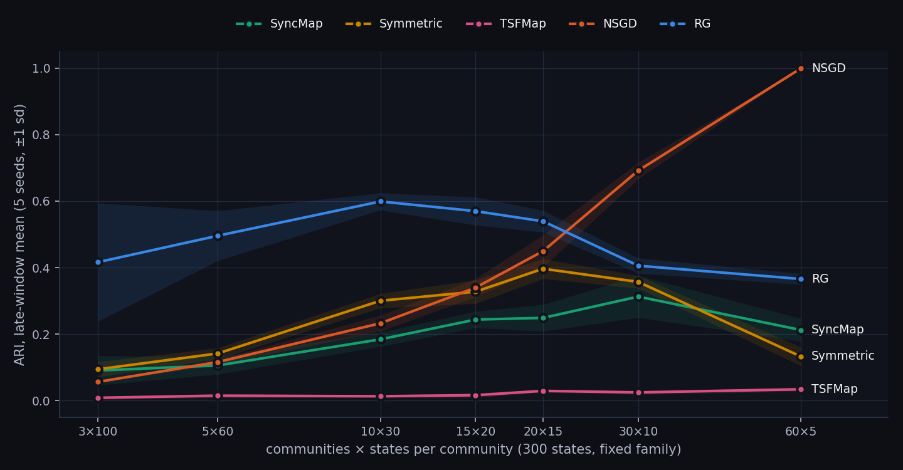
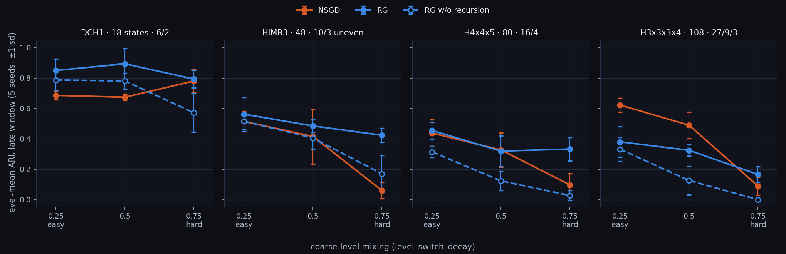

# SyncMapRGCI

[English](README.md) · **简体中文** · [日本語](README.ja.md)

SyncMapRGCI 是一个面向自组织因果推断的研究项目：目标是一个无需标签、能够发现序列中隐藏的层级块（chunk）结构、进而推断这些块之间因果关系的系统。长期目标是视觉事件序列（研究主题：*Visual Causal Inference through Hierarchical Chunking via Self-Organizing Dynamics*，即基于自组织动力学层级分块的视觉因果推断）。本项目建立在智能系统实验室（LIS）Elrion 项目中的 SyncMap 与 SyncMapX 之上。这是我的个人研究与学习资料库，始于 2025 年 10 月。

项目分为两部分：

- **RG，递归分组（Recursive Grouping，已实现）。** 在同一个几何空间内进行层级分块。同一个自组织核以更大的自然尺度（每层 x3.16）再次作用于下一层产生的 token，因此块以及由块组成的组会表现为同一张映射中的嵌套簇。
- **CI，因果推断（Causal Inference，早期实验）。** 有向关系：有向转移统计、合成 DAG 上的边恢复、线图 / 边 token 表示。

两者的结合，即 RG 所发现的块之间的因果关系，目前只有一个粗略的原型，不包含在本仓库中。当前所有实验都使用合成的图游走符号序列：在 `.dot` 图上进行随机游走以生成输入流，每个模型需要恢复图中的块（平坦图）或其嵌套的块层级（层级图）。在层级图上，游走依据节点的多层标签生成：大多数时候停留在一个块内，有时移动到兄弟块，极少跳到另一个组。标签仅用于评分。


*左：生成游走的隐藏结构。右：RG 经过 100,000 步后在其自身三维坐标中的映射；两个组相距很远，放大每个组即可看到其中的块呈现为更小的簇。*

**初次访问？** [演示文稿](docs/presentation/index.html)（带演讲者备注的 HTML 幻灯片；单文件版本和 PDF 见[发布页面](https://github.com/Cyletix/SyncMapRGCI/releases)）从原始 SyncMap 讲到最终结果，逐步讲解 RG。[文档导航](docs/README.md)列出了其余所有内容。

## 算法

主要研究方向：

- `NSGD`（`nsgd`）：一阶 SyncMap 动力学。由指数加权的共激活统计量定义一个带阈值的 k 近邻关系图；各点的位置在关系吸引力和依赖于激活的位移作用下移动，并带有逐点可塑性和有界步长。它是基准测试中最强的基线。文件：`syncmap/SyncMapX_NSGD.py`。
- `NS`（运行时名称 `ns`，通过 `--strategy ns` 选择；无预设）：由 NSGD 演化而来、支持层级的一阶核。它可以独立运行，同时也是 RG 每一层的引擎；其行为已不再与 NSGD 完全相同。文件：`syncmap/SyncMapNS.py`。
- `RG`（`rg`）：基于 `SyncMapNS` 的递归层级扩展。第 0 层学习原始符号；更高的每一层接收由下一层经无监督粗粒化产生的 token，距离、更新节奏和统计记忆随层级按几何级数增长。主要的力：基元对比力、转移图弹簧力、局部障碍斥力和有界宏观反馈。RG 还维护自己的逐层划分（`cluster_level1` 是第 0 层在原始符号上的划分，`cluster_levelN` 是第 N-1 层提升回原始符号后的划分），这些划分显示在查看器和快照 JSON 中，但不用于评分。文件：`syncmap/SyncMapRG.py`。
- `CI`（运行时名称 `ci`，通过 `--strategy ci` 选择；无预设）：独立于 RG 运行的有向转移基线。`syncmap/SyncMapCI.py` 提供有向转移统计、边恢复评估、非对称节点特征以及线图 / 边 token 表示；`syncmap/SyncMapX_CI.py` 对基于这些表示构建的原型嵌入进行聚类。它是一个研究脚手架，而不是一个完整的因果推断方法。

对比基线：

- `SyncMap`（`syncmap`）：原始 SyncMap，使用恒定学习率和其自带的 DBSCAN 读出。文件：`syncmap/SyncMap.py`。
- `Symmetric`（`symmetric`）：Symmetrical SyncMap，带有记忆窗口、对称的正/负采样以及其自带的滑动平均读出。文件：`syncmap/SyncMapX_Symmetric.py`。
- `TSF`（`tsf`）：TSFMap 风格的质心动力学，带有其自带的事后凝聚式层级读出。文件：`syncmap/SyncMapTSF.py`。

查看器使用的是各模型自带的读出；本仓库中的每一个分数都来自对坐标的同一种共享读出（见[评估](#评估)）。

## 来源

这项工作始于九州大学 Danilo Vasconcellos Vargas 教授的实验室，建立在该实验室内部的 Elrion 框架（未公开）之上。本仓库只包含我自己的代码和合成数据集，不包含未公开的 Elrion 组件。

对比基线来自已发表的工作：

- SyncMap：Vargas & Asabuki, "Continual General Chunking Problem and SyncMap", AAAI 2021。`syncmap/SyncMap.py` 移植自 https://github.com/zweifel/SyncMap 上的参考实现（MIT License, Copyright (c) 2021 zweifel），`test/` 下的图游走和块环境也源自同一发布版本。
- Symmetrical SyncMap：Zhang & Vargas, "Symmetrical SyncMap for Imbalanced General Chunking Problems", arXiv:2310.10045。
- TSFMap：Vargas, Tham & Zhang, "Dynamical Equations with Bottom-up Self-Organizing Properties Learn Accurate Dynamical Hierarchies without any Loss Function", arXiv:2302.02140, 2023。`syncmap/SyncMapTSF.py` 是对其动力学的独立重新实现。

## 安装

Python 3.11。`pygraphviz`（用于读取 `.dot` 数据集）需要先安装 Graphviz 的 C 库和头文件。

```bash
sudo apt install graphviz graphviz-dev
conda create -n syncmaprgci python=3.11
conda activate syncmaprgci
pip install -r requirements.txt
```

没有 root 权限时，`conda install -c conda-forge pygraphviz` 会把 Graphviz 和 `pygraphviz` 一起安装。只有交互式查看器（任务 1，以及带 `--live` 的任务 0）才需要 `PyQt5` 和显示器。在无显示器（headless）的机器上，请设置 `MPLBACKEND=Agg`。

## 使用方法

`main.py` 负责运行所有实验任务；`tools/` 中的脚本在其基础上构建基准测试、补充实验及其报告。请在仓库根目录下运行。数据集路径可以省略 `datasets/`。

并排观察全部五个模型学习深层层级，并实时显示 ARI/NMI 曲线（需要 Qt 和显示器）：

```bash
python main.py --task 1 --strategy syncmap symmetric tsf nsgd rg --dataset hierarchy/IEH_fixed_chunk_deep_hierarchy.dot --steps 1000000 --record-interval 5000 --seed 0
```

在 DCH1 上运行一次 RG，输出最终映射（PNG）、训练轨迹（GIF）及其 ARI 曲线，写入 `results/picture/`、`results/animations/` 和 `results/snapshots/`。其 `result:` 行为 `... ari=0.8836 ... L1=0.7671 L2=1.0000`：

```bash
python main.py --task 0 --strategy rg --dataset hierarchy/DCH1_fixed_chunk_6_3.dot --steps 100000 --seed 0 --save-png true --save-gif true --trace true --save-plot true
```

在 `datasets/` 中的 39 个平坦图和包含 10 个图的层级测试集（`--datasets flat hierarchy`，共 49 个图）上进行批量对比，使用五个随机种子，CSV 和 Markdown 报告写入 `results/experiment/<timestamp>/`（耗时较长）：

```bash
python main.py --task 2 --datasets flat hierarchy --profiles syncmap symmetric tsf nsgd rg --comparison-sequence-lengths 5000 100000 --comparison-trials 5 --metric ari --seed 0
```

重新构建下文所示的基准测试（8 个图、5 个模型、5 个随机种子，含图表和 GIF）：

```bash
python tools/benchmark.py run
```

`--set key=value` 可在单次运行中覆盖某个模型参数，`python main.py --list-profiles` 会列出所有预设。全部任务和命令行参数见 [docs/CLI_REFERENCE.md](docs/CLI_REFERENCE.md)。

## 实验参数

共享的输入环境：

- 映射维度：3。
- 输入编码器：每个节点保持 11 个输入步（`TIME_DELAY = 10`）；输入向量包含以 `exp(-0.1 t)` 衰减的当前节点，以及前一个节点的较弱痕迹。在层级图上，游走以 0.45 的概率在块之间跳转，在往上 k 层的组之间跳转的概率为 0.45 × 0.25^k（[详情](docs/DESIGN_REFERENCE.md#input-environments)）。
- 学习率（`adaptation_rate`）：NSGD 和 RG 为 0.05，TSF 为 0.001；SyncMap 和 Symmetric 使用 `clip(0.001 x number_of_symbols, 0.05, 0.1)`。`--set adaptation_rate=...` 可覆盖其中任意一个。

各配置（profile）的参数（`tools/main_config.py`，`VARIANT_CONFIGS`）；这里列出的读出设置是各模型自带的读出，而不是评分用的读出：

- `nsgd`：`adaptation_rate=0.05`、`stats_memory_steps=100`、`plasticity_decay=0.99`、`plasticity_min=0.01`、`plasticity_recovery=1.0`、`knn=12`、`graph_theta=0.1`、`k_attr=1.0`、`k_pulse=2.0`、`k_repulse=0.0`、`max_step_norm=5.0`、`T_push=10`，读出为 DBSCAN `eps=1.0`、`min_samples=3`，每 100 步重新聚类一次。
- `rg`：无覆盖项；使用 `syncmap/SyncMapRG.py` 中的 `SyncMapX_RG.DEFAULT_PARAMS`。关键取值：`adaptation_rate=0.05`、`level_count=2`（在层级图上自动提升为深度 + 1 层，例如 DCH1 上为 3 层、IEH 上为 5 层；平坦图会禁用上层）、`stats_mode=transition`、`stats_memory_steps=300` 配合每层 `stats_memory_scale=10`、每层距离尺度 x3.16、`warmup_steps=2000`、`k_attr=0.07`、`k_repulse=1.0`、`k_macro_repulse=0.1`，读出为 `physical_mst_gaps`。
- `syncmap`：DBSCAN `eps=3.0`、`min_samples=2`、`space_size=10`。
- `symmetric`：`state_memory=3`、`stochastic_prob=0.3`、`moving_average_window=10000`、DBSCAN `eps=4.5`、`min_samples=2`。
- `tsf`：`adaptation_rate=0.001`、`velocity_decay=0.999`、`mu_pos=6`、`mu_neg=3`、`mu_repulse=2`，读出为 Ward 凝聚聚类，`target_levels=3`，簇数为 2-16。
- 敏感性预设：`rg_shortmem`、`rg_shortmem_l0`、`tsf_longmem`、`tsf_velocity_longmem`。它们是受控变体，而不是独立的算法。

任务 2 的默认设置（`MAIN_CONFIG`）：序列长度 5,000 和 100,000，5 次试验，指标为 ARI。不指定 `--profiles` 时，任务 2 将 `syncmap nsgd rg tsf` 作为策略运行，并使用各自类的默认参数，而不是上面的预设；传入 `--profiles` 才会使用预设。

## 基准测试

八个代表性场景，全部五个模型，100,000 个输入步，五个随机种子（0-4）。完整报告包含逐层分数、潜空间映射、分数曲线，以及每个模型在每个图上的 GIF：[results/benchmark/REPORT.md](results/benchmark/REPORT.md)。

| 场景 | 类型 | 节点数 | 类别数（由细到粗） | 测试内容 |
|---|---|---:|---|---|
| `fixed5_6` | 平坦 | 30 | 5 | 参照情形：大小相等、顺序固定的块 |
| `UB_mixed_chunk_20_5_5` | 平坦 | 30 | 3 | 大小差异很大的块 |
| `imbalanced_fixed_300` | 平坦 | 300 | 14 | 大图，块大小不均衡 |
| `chain_mixed5_60` | 平坦 | 300 | 5 | 长链状的块，访问稀疏 |
| `DCH1` | 层级 | 18 | 6 / 2 | 两层层级 |
| `IH` | 层级 | 18 | 5 / 2 | 不平衡的层级 |
| `EC` | 层级 | 33 | 15 / 2 | 两个组下的大量小块 |
| `IEH` | 层级 | 18 | 7 / 5 / 4 / 2 | 四层层级 |


ARI，五个随机种子的均值 ± 标准差（粗体 = 最佳；层级图的分数为所有层的平均值）：

| 场景 | SyncMap | Symmetric | TSFMap | NSGD | RG |
|---|---:|---:|---:|---:|---:|
| fixed5_6 | 0.516 ± 0.119 | 0.747 ± 0.141 | 0.788 ± 0.199 | **1.000 ± 0.000** | 0.957 ± 0.033 |
| UB_mixed_chunk_20_5_5 | 0.253 ± 0.170 | **0.594 ± 0.178** | 0.049 ± 0.148 | 0.357 ± 0.064 | 0.592 ± 0.296 |
| imbalanced_fixed_300 | 0.181 ± 0.041 | 0.367 ± 0.135 | 0.012 ± 0.006 | 0.202 ± 0.022 | **0.505 ± 0.090** |
| chain_mixed5_60 | **0.349 ± 0.121** | 0.320 ± 0.089 | 0.022 ± 0.012 | 0.340 ± 0.098 | 0.332 ± 0.079 |
| DCH1 | 0.632 ± 0.003 | 0.643 ± 0.018 | 0.691 ± 0.083 | 0.665 ± 0.033 | **0.795 ± 0.141** |
| IH | 0.221 ± 0.078 | -0.022 ± 0.050 | 0.346 ± 0.311 | **0.924 ± 0.000** | 0.920 ± 0.039 |
| EC | 0.542 ± 0.000 | 0.542 ± 0.000 | 0.281 ± 0.178 | 0.606 ± 0.084 | **0.700 ± 0.121** |
| IEH | 0.341 ± 0.143 | 0.220 ± 0.261 | 0.463 ± 0.082 | **0.654 ± 0.081** | 0.640 ± 0.129 |

主要发现：

- 大小相等的平坦块（`fixed5_6`）：NSGD 在每个随机种子上都达到满分；RG 接近满分。
- 大小不等和不均衡的块：RG 在 300 节点的不均衡图上表现最好（0.505，其他模型最高为 0.367），在 `UB_mixed_chunk_20_5_5` 上与 Symmetric 持平，但随机种子之间差异很大。
- 链状结构（`chain_mixed5_60`）：没有模型能解决。SyncMap 系列模型停留在 0.32-0.35 左右，TSFMap 失败，这与已知的链状结构失效问题一致。
- 层级：在 `DCH1` 和 `EC` 上，SyncMap、Symmetric、NSGD 和 RG 都能恢复粗层的组（第 2 层 ARI 为 1.0）。差别在于细层，RG 在细层上领先于其他几个模型（0.589 和 0.399，其他模型最高分别为 0.330 和 0.211）。TSFMap 表现出相反的模式：细层最好（0.966、0.498），粗层最弱（0.416、0.064）。总体而言，RG 在这两个图上都是最好的。
- 不平衡层级（`IH`）：NSGD 和 RG 达到约 0.92；TSFMap 在不同随机种子间波动，Symmetric 失败。
- 深层层级（`IEH`）：NSGD 与 RG 持平。RG 在第 1 层和第 3 层领先，SyncMap 在第 2 层领先，NSGD 在最粗的一层领先。
- 开销：RG 每次 100,000 步的运行耗时 16-89 秒，而 NSGD 为 4-9 秒（多个运行并行执行）。
- 单个随机种子的分数曲线在训练后期仍持续波动，因此表格取五个随机种子的平均值。

`EC` 上的最终三维布局（随机种子 0，各模型自身的坐标，按真实的细层块着色）。SyncMap、Symmetric、NSGD 和 RG 将块分为两个相互分离的组；TSFMap 则把块均匀地分布在整个空间中，因此粗层始终没有出现：


`EC` 上的训练过程（随机种子 0；镜头缓慢旋转以展示深度）：

| SyncMap | Symmetric | TSFMap | NSGD | RG |
|---|---|---|---|---|
|  |  |  |  |  |

重新运行全部实验（使用默认的 3 个工作进程约需 40 分钟；在 300 节点的图上，每个批处理进程可能占用数 GB），或者只重新生成图表和报告：

```bash
python tools/benchmark.py run
python tools/benchmark.py report
```

此处的 SyncMap 和 Symmetric 基线使用各自论文中的恒定学习率。

## 补充实验

基准测试无法说明 NSGD 或 RG 各自在何处胜出，而且其层级在粗层上过于简单，因此在其之后设计了这些后续实验：11 个图（其中 8 个为生成的），五个模型外加关闭递归的 RG，五个配对的随机种子，100,000 步，以最后五个检查点的均值评分。完整报告：[results/supp/REPORT.md](results/supp/REPORT.md)。

- **社区取向决定平坦图上的胜者。** 在状态数固定为 300 时，从 3 个各含 100 个状态的社区到 15 个各含 20 个状态的社区，RG 在每个随机种子上都胜过 NSGD（领先 0.23-0.38 ARI）；从 30 个各含 10 个状态的社区开始 NSGD 胜出，并在 60 个各含 5 个状态的社区上达到满分。
- **更难的粗层能把两者区分开。** 当游走在顶层的组之间混合得更多时，NSGD 在新的层级图上崩溃（0.06-0.10），而 RG 仍保持 0.17-0.42。在较容易的混合设置下，两者在两个图上持平，RG 在 DCH1 上领先，NSGD 在三层的图上领先。
- **起作用的正是递归。** 在全部 12 个层级设置中，去掉递归的 RG 都低于完整的 RG（低 0.05-0.31），且混合越难，差距越大。
- **读出方式很重要。** 若使用真实的簇数（oracle-K 诊断，即预先给定正确的簇数 K），RG 的映射在 12 个设置中有 11 个与 NSGD 持平或更优；正式的 MST 切分使每个模型损失 0.07-0.40 ARI。





```bash
python tools/make_supp_datasets.py --stats
python tools/supp_run.py run --workers 3
python tools/supp_run.py showcase
python tools/supp_report.py
```

## 评估

- 每种方法都通过对其当前坐标的同一种无监督读出来评分；真实标签只用于评分，从不用于选择层。
- 平坦图：在标准化坐标上运行 DBSCAN（eps = 1.25 × k 距离的中位数，`min_samples=2`）；计算该划分的 ARI / NMI。
- 层级图：在相邻边之间的大间隙处（比值 ≥ 1.05）切分欧氏最小生成树，每个所需的层切分一次。正式 ARI 是所需深度内 `cluster_level1` ... `cluster_levelN` 的平均值，缺失的层记为零分。NMI 仍作为固定层的诊断指标；共表型相关系数（cophenetic correlation）和逐层分数提供额外的参考信息。
- 仅作诊断：`oracle_cluster_levelN_ari_score` 在真实簇数下用 Ward 聚类切分同一组坐标。oracle 分数高而正式分数低，说明映射中包含了该结构，只是读出没有捕捉到。
- 指定 `--seed` 时，输入流来自环境私有的随机数流，因此对于给定的随机种子，每个模型看到的序列都相同。

## 仓库结构

- `main.py`：命令行入口和任务分派。
- `unified_experiments.py`：模型与环境的构建、训练循环、评估、批量对比。
- `live.py`：交互式查看器后端（任务 1）。
- `syncmap/`：算法实现。
- `test/`：运行时使用的图游走与层级环境，以及针对性的单元测试。
- `tools/`：配置（`main_config.py`）、读出与指标、绘图、CSV 汇总、基准测试（`benchmark.py`）、补充实验（`make_supp_datasets.py`、`supp_run.py`、`supp_report.py`）以及演示文稿中的示意图（`deck_figures.py`）。
- `datasets/`：合成的 `.dot` 图；层级图位于 `datasets/hierarchy/`；为补充实验生成的图位于 `datasets/supp/`。
- `results/benchmark/`：基准测试报告、对比 CSV、图表和 GIF。`results/supp/`：补充实验报告、对比 CSV 和图表。其他 `results/` 文件夹是运行输出，不纳入版本跟踪。
- `docs/`：文档导航、演示文稿、设计参考、CLI 参考、输出位置、计划与局限性。

## 文档

- [文档导航](docs/README.md)
- [演示文稿](docs/presentation/index.html)（HTML 幻灯片；单文件版本和 PDF 见[发布页面](https://github.com/Cyletix/SyncMapRGCI/releases)）
- [基准测试报告](results/benchmark/REPORT.md)和[补充实验报告](results/supp/REPORT.md)
- [设计与评估](docs/DESIGN_REFERENCE.md)
- [CLI 参考](docs/CLI_REFERENCE.md)
- [仓库结构](docs/PROJECT_STRUCTURE.md)
- [输出位置](docs/OUTPUT_GOVERNANCE.md)
- [开放问题](docs/PLAN.md)和[已知局限](docs/ISSUES_LOG.md)

## 局限性

- 相同的输入步数并不意味着各方法的计算量或内存相同。
- 基准测试覆盖八个合成图，补充实验覆盖十一个（其中八个是专门为其生成的）；它们展示的是在代表性和受控情形下的行为，而不是普遍的优越性。
- 层级读出是基于单个检查点的 MST 间隙切分。它可能漏掉映射已清晰分开的粗层组；在把较低的粗层分数解读为表示失败之前，请先与 oracle-K 列进行比较。
- RG 默认的层调度器会使深层时钟发生混叠（aliasing），因此在 100,000 步内，L1 以上的层获得的证据很少（[详情](docs/ISSUES_LOG.md)）。
- 层级数据集通过路径（`datasets/hierarchy/`）或 `.dot` 内容（内部节点或多层标签）来识别；`--env-mode` 可覆盖这一识别。
- CI 仍处于探索阶段；尚未建立经过验证的因果推断系统。
