# Benchmark report

8 representative graphs, 5 models, 100,000 input steps, 5 seeds (0-4). Generated by `tools/benchmark.py`; every run goes through `main.py`.

## Setup

| Dataset | File | Family | Nodes | Classes per level (fine to coarse) |
|---|---|---|---:|---|
| fixed5_6 | `datasets/fixed5_6.dot` | flat | 30 | 5 |
| UB_mixed_chunk_20_5_5 | `datasets/UB_mixed_chunk_20_5_5.dot` | flat | 30 | 3 |
| imbalanced_fixed_300 | `datasets/imbalanced_fixed_300.dot` | flat | 300 | 14 |
| chain_mixed5_60 | `datasets/chain_mixed5_60.dot` | flat | 300 | 5 |
| DCH1 | `datasets/hierarchy/DCH1_fixed_chunk_6_3.dot` | hierarchy | 18 | 6 / 2 |
| IH | `datasets/hierarchy/IH_fixed_chunk_unbalanced.dot` | hierarchy | 18 | 5 / 2 |
| EC | `datasets/hierarchy/EC_fixed_chunk_15_3.dot` | hierarchy | 33 | 15 / 2 |
| IEH | `datasets/hierarchy/IEH_fixed_chunk_deep_hierarchy.dot` | hierarchy | 18 | 7 / 5 / 4 / 2 |

- Models: SyncMap (`syncmap`), Symmetric (`symmetric`), TSFMap (`tsf`), NSGD (`nsgd`), RG (`rg`), each with its maintained profile.
- Score: ARI against the true chunks; on hierarchy graphs the mean ARI over every required level (a missing level scores 0). NMI is reported alongside.
- Comparison: `python main.py --task 2 --profiles syncmap symmetric tsf nsgd rg --datasets <file> --comparison-sequence-lengths 100000 --comparison-trials 5 --metric ari --seed 0`.
- Showcase (figures, curves, GIFs): `python main.py --task 0 --profile <model> --dataset <file> --steps 100000 --seed 0 --trace true`.

## Results

ARI, mean ± std over seeds:

| Dataset | SyncMap | Symmetric | TSFMap | NSGD | RG |
|---|---:|---:|---:|---:|---:|
| fixed5_6 | 0.516 ± 0.119 | 0.747 ± 0.141 | 0.788 ± 0.199 | **1.000 ± 0.000** | 0.957 ± 0.033 |
| UB_mixed_chunk_20_5_5 | 0.253 ± 0.170 | **0.594 ± 0.178** | 0.049 ± 0.148 | 0.357 ± 0.064 | 0.592 ± 0.296 |
| imbalanced_fixed_300 | 0.181 ± 0.041 | 0.367 ± 0.135 | 0.012 ± 0.006 | 0.202 ± 0.022 | **0.505 ± 0.090** |
| chain_mixed5_60 | **0.349 ± 0.121** | 0.320 ± 0.089 | 0.022 ± 0.012 | 0.340 ± 0.098 | 0.332 ± 0.079 |
| DCH1 | 0.632 ± 0.003 | 0.643 ± 0.018 | 0.691 ± 0.083 | 0.665 ± 0.033 | **0.795 ± 0.141** |
| IH | 0.221 ± 0.078 | -0.022 ± 0.050 | 0.346 ± 0.311 | **0.924 ± 0.000** | 0.920 ± 0.039 |
| EC | 0.542 ± 0.000 | 0.542 ± 0.000 | 0.281 ± 0.178 | 0.606 ± 0.084 | **0.700 ± 0.121** |
| IEH | 0.341 ± 0.143 | 0.220 ± 0.261 | 0.463 ± 0.082 | **0.654 ± 0.081** | 0.640 ± 0.129 |

NMI, mean ± std over seeds:

| Dataset | SyncMap | Symmetric | TSFMap | NSGD | RG |
|---|---:|---:|---:|---:|---:|
| fixed5_6 | 0.723 ± 0.054 | 0.861 ± 0.069 | 0.896 ± 0.100 | 1.000 ± 0.000 | 0.970 ± 0.024 |
| UB_mixed_chunk_20_5_5 | 0.502 ± 0.081 | 0.648 ± 0.063 | 0.376 ± 0.141 | 0.677 ± 0.033 | 0.781 ± 0.140 |
| imbalanced_fixed_300 | 0.570 ± 0.033 | 0.659 ± 0.067 | 0.283 ± 0.027 | 0.699 ± 0.015 | 0.752 ± 0.036 |
| chain_mixed5_60 | 0.373 ± 0.103 | 0.345 ± 0.065 | 0.170 ± 0.011 | 0.398 ± 0.132 | 0.386 ± 0.115 |
| DCH1 | 0.563 ± 0.011 | 0.591 ± 0.047 | 0.984 ± 0.035 | 0.643 ± 0.082 | 0.819 ± 0.136 |
| IH | 0.516 ± 0.077 | 0.019 ± 0.044 | 0.638 ± 0.358 | 0.859 ± 0.000 | 0.853 ± 0.068 |
| EC | 0.409 ± 0.000 | 0.409 ± 0.000 | 0.728 ± 0.409 | 0.618 ± 0.166 | 0.780 ± 0.174 |
| IEH | 0.804 ± 0.092 | 0.331 ± 0.322 | 0.817 ± 0.060 | 0.777 ± 0.193 | 0.857 ± 0.025 |

Mean wall-clock seconds per run:

| Dataset | SyncMap | Symmetric | TSFMap | NSGD | RG |
|---|---:|---:|---:|---:|---:|
| fixed5_6 | 3.1 | 7.7 | 6.3 | 4.5 | 18.6 |
| UB_mixed_chunk_20_5_5 | 3.1 | 7.5 | 6.3 | 4.5 | 16.4 |
| imbalanced_fixed_300 | 4.8 | 10.4 | 12.0 | 8.8 | 31.6 |
| chain_mixed5_60 | 4.5 | 10.6 | 12.8 | 9.3 | 27.7 |
| DCH1 | 2.3 | 7.5 | 5.2 | 4.4 | 63.3 |
| IH | 2.4 | 7.5 | 5.4 | 4.6 | 67.5 |
| EC | 2.7 | 7.4 | 6.2 | 5.2 | 89.2 |
| IEH | 2.2 | 6.4 | 4.6 | 4.6 | 64.5 |

## fixed5_6

Final layout at 100,000 steps (seed 0, each model in its own 3-D space, coloured by true finest chunk):

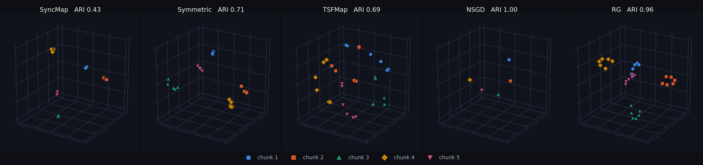

ARI during training (seed 0):

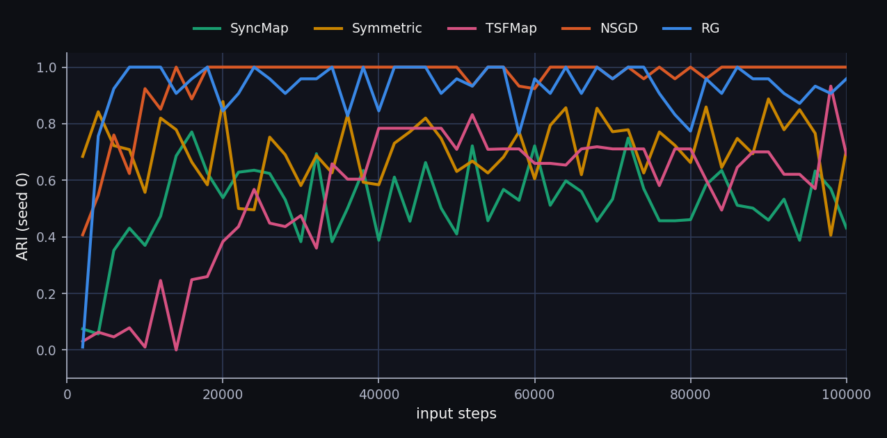

Training trajectories in 3-D (seed 0, coloured by true chunk, slowly rotating camera): [SyncMap](gifs/fixed5_6__syncmap.gif), [Symmetric](gifs/fixed5_6__symmetric.gif), [TSFMap](gifs/fixed5_6__tsf.gif), [NSGD](gifs/fixed5_6__nsgd.gif), [RG](gifs/fixed5_6__rg.gif)

| SyncMap | Symmetric | TSFMap | NSGD | RG |
|---|---|---|---|---|
| 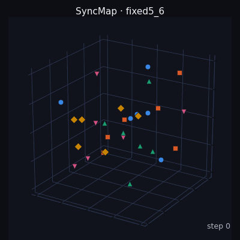 | 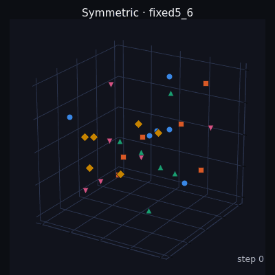 | 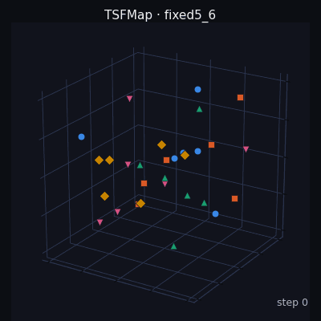 | 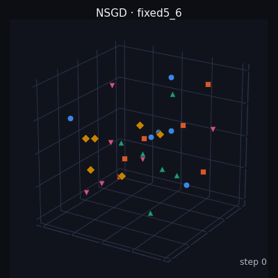 | 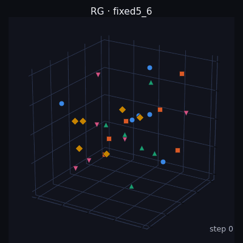 |

## UB_mixed_chunk_20_5_5

Final layout at 100,000 steps (seed 0, each model in its own 3-D space, coloured by true finest chunk):

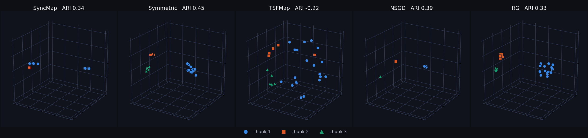

ARI during training (seed 0):

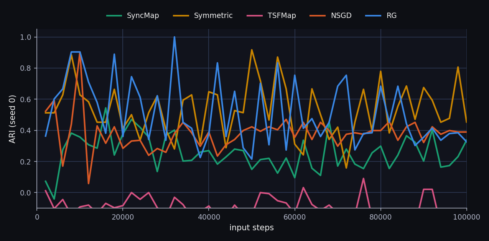

Training trajectories in 3-D (seed 0, coloured by true chunk, slowly rotating camera): [SyncMap](gifs/UB_mixed_chunk_20_5_5__syncmap.gif), [Symmetric](gifs/UB_mixed_chunk_20_5_5__symmetric.gif), [TSFMap](gifs/UB_mixed_chunk_20_5_5__tsf.gif), [NSGD](gifs/UB_mixed_chunk_20_5_5__nsgd.gif), [RG](gifs/UB_mixed_chunk_20_5_5__rg.gif)

| SyncMap | Symmetric | TSFMap | NSGD | RG |
|---|---|---|---|---|
|  | 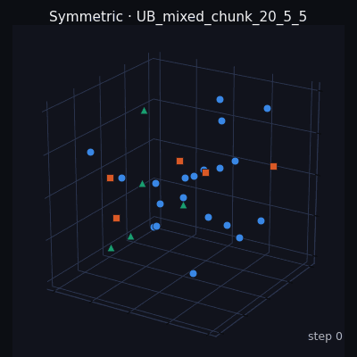 | 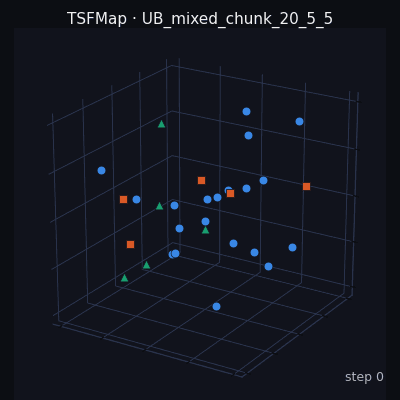 | 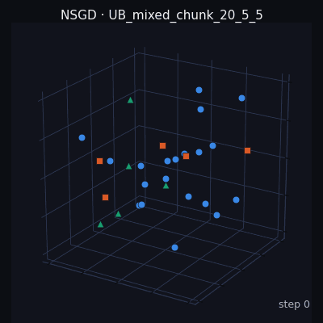 | 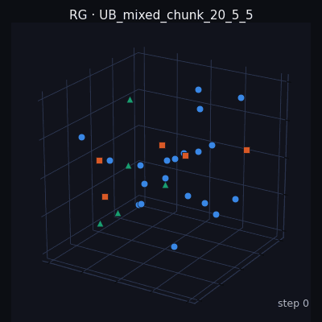 |

## imbalanced_fixed_300

Final layout at 100,000 steps (seed 0, each model in its own 3-D space, coloured by true finest chunk):

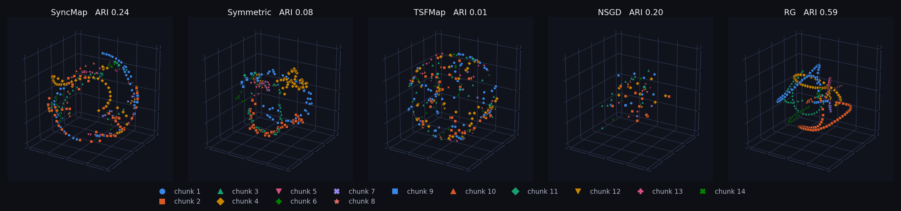

ARI during training (seed 0):

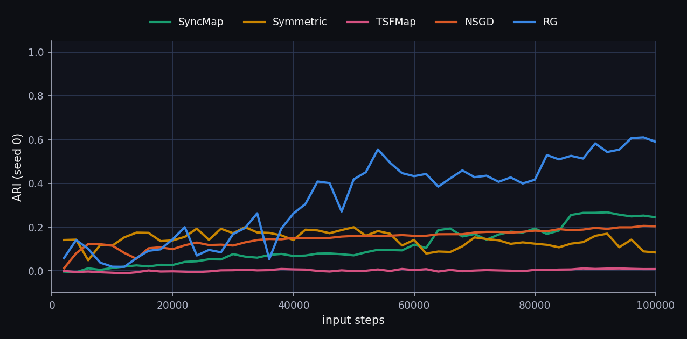

Training trajectories in 3-D (seed 0, coloured by true chunk, slowly rotating camera): [SyncMap](gifs/imbalanced_fixed_300__syncmap.gif), [Symmetric](gifs/imbalanced_fixed_300__symmetric.gif), [TSFMap](gifs/imbalanced_fixed_300__tsf.gif), [NSGD](gifs/imbalanced_fixed_300__nsgd.gif), [RG](gifs/imbalanced_fixed_300__rg.gif)

| SyncMap | Symmetric | TSFMap | NSGD | RG |
|---|---|---|---|---|
| 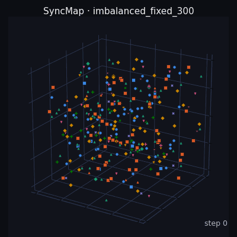 | 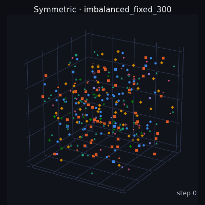 | 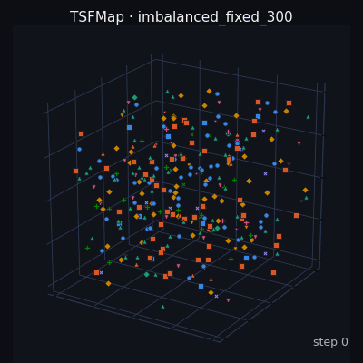 | 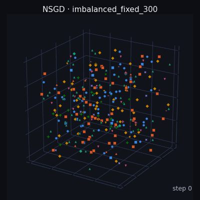 | 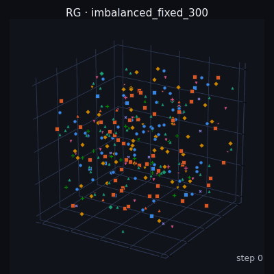 |

## chain_mixed5_60

Final layout at 100,000 steps (seed 0, each model in its own 3-D space, coloured by true finest chunk):

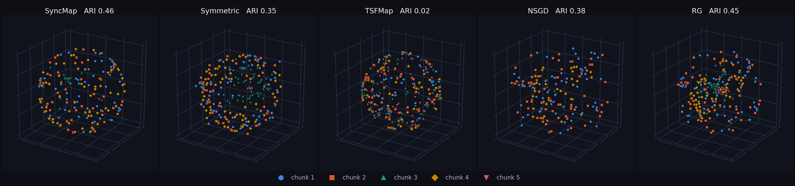

ARI during training (seed 0):

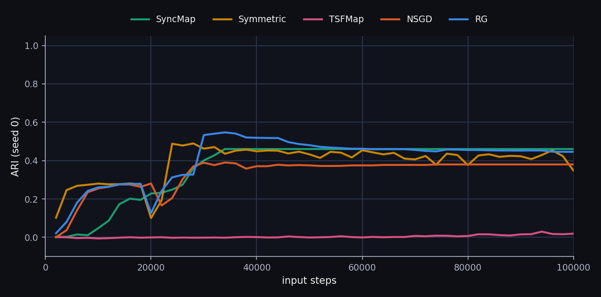

Training trajectories in 3-D (seed 0, coloured by true chunk, slowly rotating camera): [SyncMap](gifs/chain_mixed5_60__syncmap.gif), [Symmetric](gifs/chain_mixed5_60__symmetric.gif), [TSFMap](gifs/chain_mixed5_60__tsf.gif), [NSGD](gifs/chain_mixed5_60__nsgd.gif), [RG](gifs/chain_mixed5_60__rg.gif)

| SyncMap | Symmetric | TSFMap | NSGD | RG |
|---|---|---|---|---|
|  | 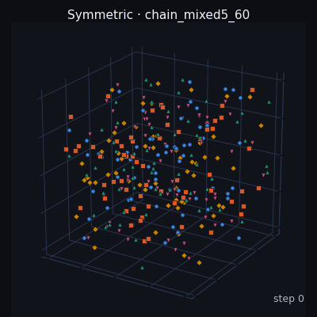 | 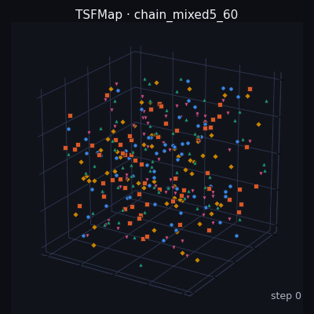 | 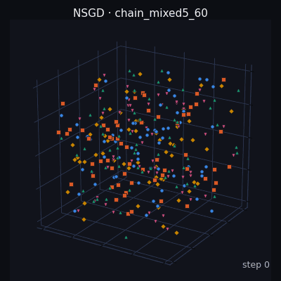 | 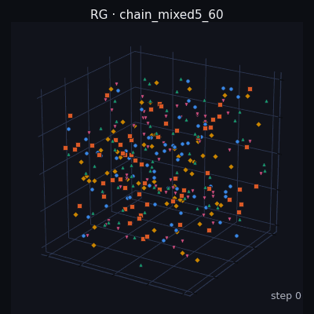 |

## DCH1

Per-level ARI, mean over seeds (level 1 = finest):

| Model | level 1 | level 2 |
|---|---:|---:|
| SyncMap | 0.263 | 1.000 |
| Symmetric | 0.285 | 1.000 |
| TSFMap | 0.966 | 0.416 |
| NSGD | 0.330 | 1.000 |
| RG | 0.589 | 1.000 |

Final layout at 100,000 steps (seed 0, each model in its own 3-D space, coloured by true finest chunk):

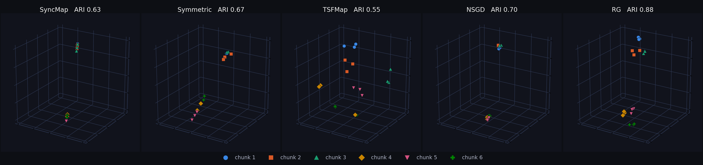

ARI during training (seed 0):

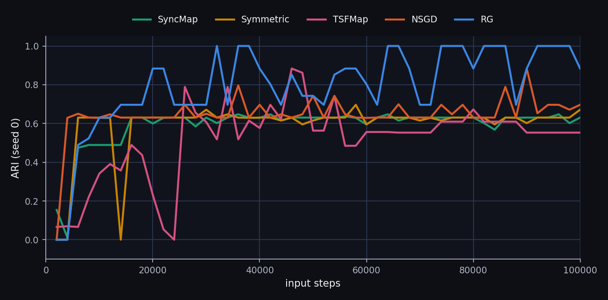

Training trajectories in 3-D (seed 0, coloured by true chunk, slowly rotating camera): [SyncMap](gifs/DCH1__syncmap.gif), [Symmetric](gifs/DCH1__symmetric.gif), [TSFMap](gifs/DCH1__tsf.gif), [NSGD](gifs/DCH1__nsgd.gif), [RG](gifs/DCH1__rg.gif)

| SyncMap | Symmetric | TSFMap | NSGD | RG |
|---|---|---|---|---|
| 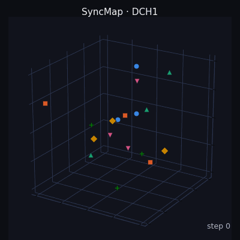 | 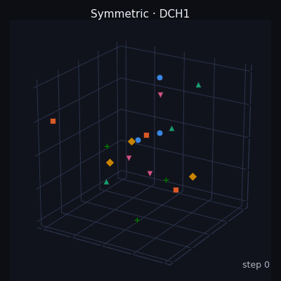 |  | 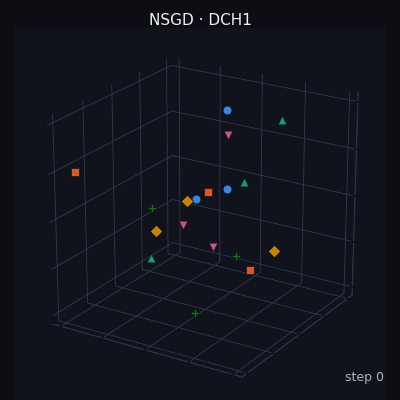 | 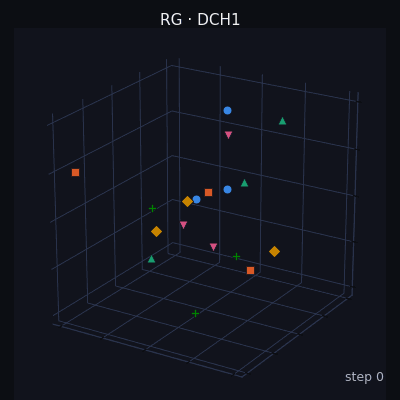 |

## IH

Per-level ARI, mean over seeds (level 1 = finest):

| Model | level 1 | level 2 |
|---|---:|---:|
| SyncMap | 0.372 | 0.070 |
| Symmetric | -0.022 | -0.023 |
| TSFMap | 0.421 | 0.271 |
| NSGD | 0.847 | 1.000 |
| RG | 0.839 | 1.000 |

Final layout at 100,000 steps (seed 0, each model in its own 3-D space, coloured by true finest chunk):

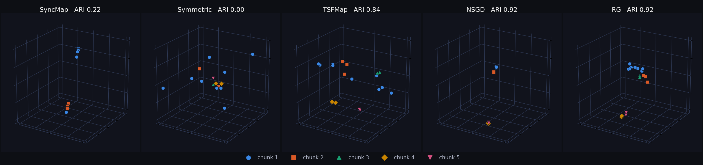

ARI during training (seed 0):

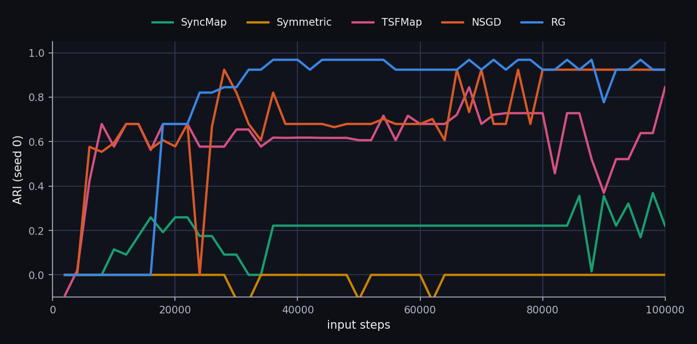

Training trajectories in 3-D (seed 0, coloured by true chunk, slowly rotating camera): [SyncMap](gifs/IH__syncmap.gif), [Symmetric](gifs/IH__symmetric.gif), [TSFMap](gifs/IH__tsf.gif), [NSGD](gifs/IH__nsgd.gif), [RG](gifs/IH__rg.gif)

| SyncMap | Symmetric | TSFMap | NSGD | RG |
|---|---|---|---|---|
| 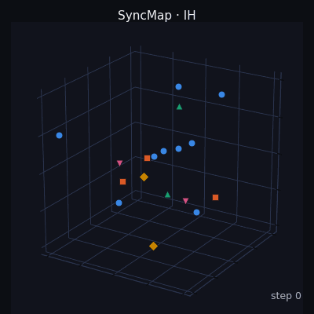 | 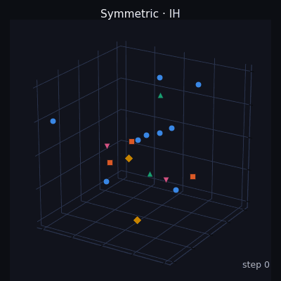 | 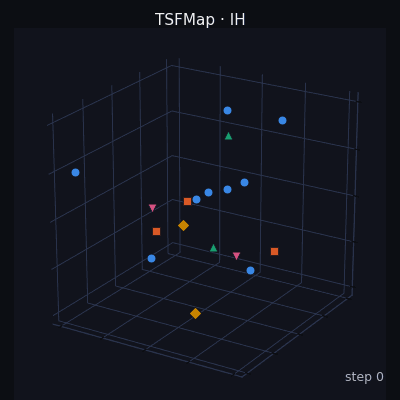 | 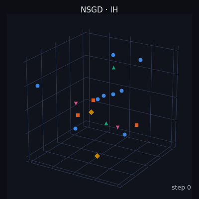 | 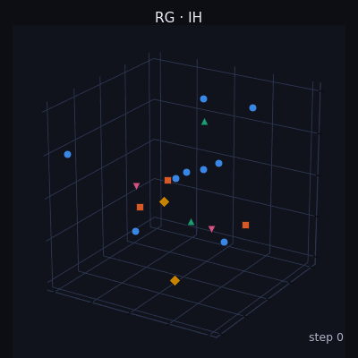 |

## EC

Per-level ARI, mean over seeds (level 1 = finest):

| Model | level 1 | level 2 |
|---|---:|---:|
| SyncMap | 0.084 | 1.000 |
| Symmetric | 0.084 | 1.000 |
| TSFMap | 0.498 | 0.064 |
| NSGD | 0.211 | 1.000 |
| RG | 0.399 | 1.000 |

Final layout at 100,000 steps (seed 0, each model in its own 3-D space, coloured by true finest chunk):

ARI during training (seed 0):

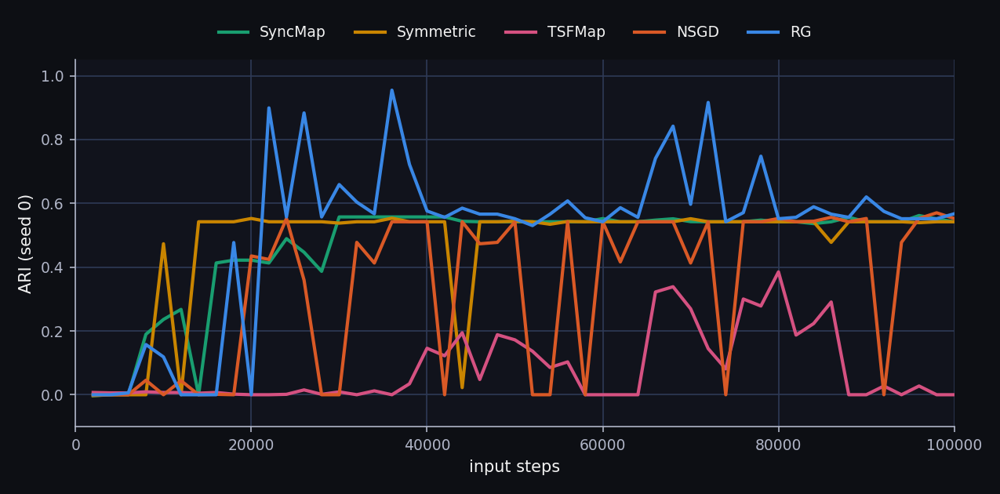

Training trajectories in 3-D (seed 0, coloured by true chunk, slowly rotating camera): [SyncMap](gifs/EC__syncmap.gif), [Symmetric](gifs/EC__symmetric.gif), [TSFMap](gifs/EC__tsf.gif), [NSGD](gifs/EC__nsgd.gif), [RG](gifs/EC__rg.gif)

| SyncMap | Symmetric | TSFMap | NSGD | RG |
|---|---|---|---|---|
|  |  |  |  |  |

## IEH

Per-level ARI, mean over seeds (level 1 = finest):

| Model | level 1 | level 2 | level 3 | level 4 |
|---|---:|---:|---:|---:|
| SyncMap | 0.479 | 0.761 | 0.100 | 0.023 |
| Symmetric | 0.134 | 0.183 | 0.270 | 0.292 |
| TSFMap | 0.481 | 0.688 | 0.374 | 0.310 |
| NSGD | 0.477 | 0.456 | 0.683 | 1.000 |
| RG | 0.568 | 0.572 | 0.850 | 0.570 |

Final layout at 100,000 steps (seed 0, each model in its own 3-D space, coloured by true finest chunk):

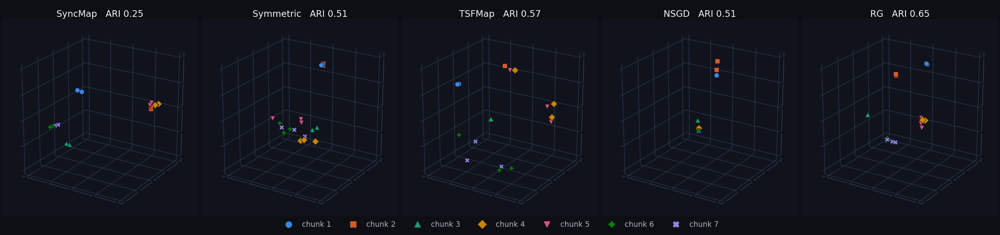

ARI during training (seed 0):

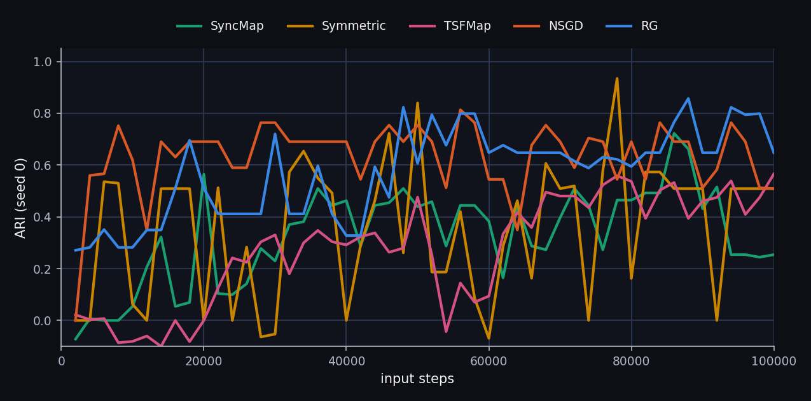

Training trajectories in 3-D (seed 0, coloured by true chunk, slowly rotating camera): [SyncMap](gifs/IEH__syncmap.gif), [Symmetric](gifs/IEH__symmetric.gif), [TSFMap](gifs/IEH__tsf.gif), [NSGD](gifs/IEH__nsgd.gif), [RG](gifs/IEH__rg.gif)

| SyncMap | Symmetric | TSFMap | NSGD | RG |
|---|---|---|---|---|
| 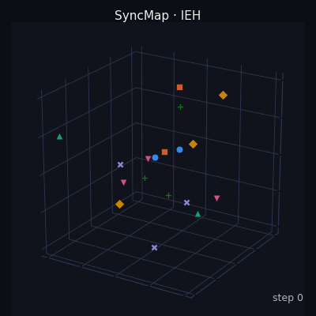 | 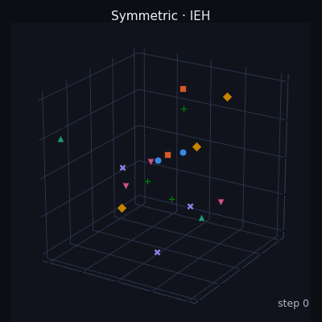 | 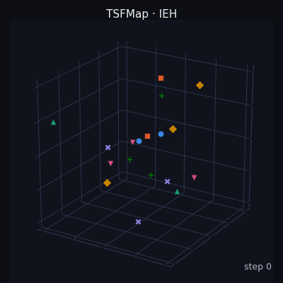 | 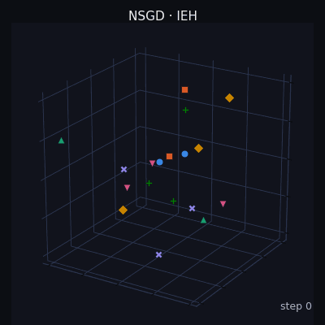 | 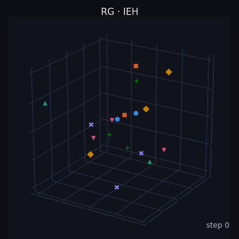 |

## Files

- `comparison_full_results.csv`: every comparison run with its scores and effective parameters.
- `runs/<dataset>__<model>.json`: seed-0 showcase run: scores, final coordinates, true and predicted labels, ARI/NMI curve.
- `figures/`, `gifs/`: the images above.
