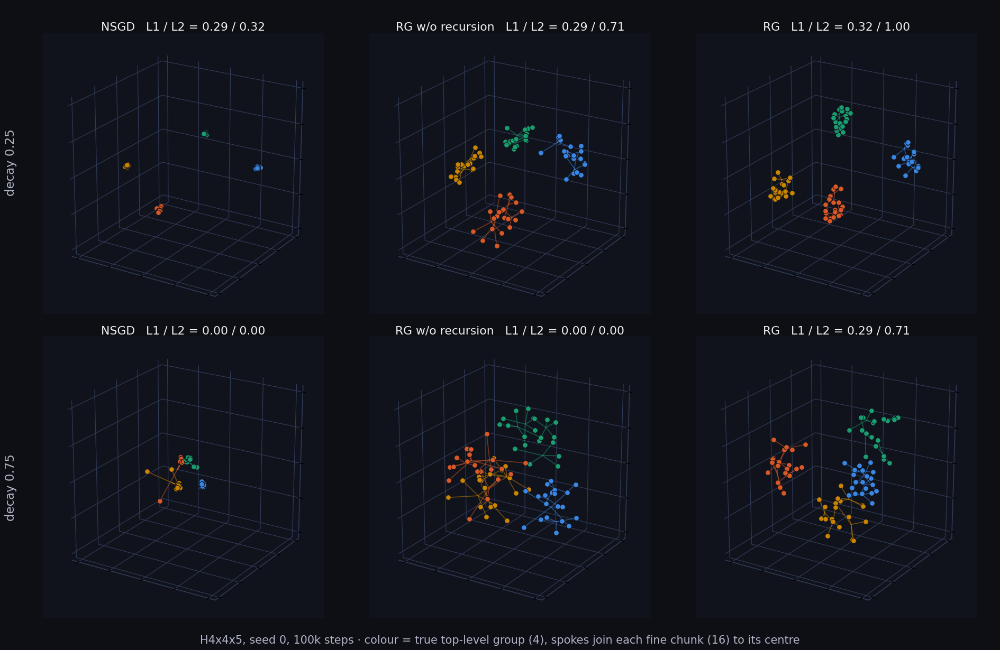

# Supplementary experiments

Targeted follow-ups to the [benchmark](../benchmark/REPORT.md), designed after it showed two gaps: its flat graphs cannot say *where* NSGD or RG wins, and its hierarchies are too easy at the coarse level (four of five models get level-2 ARI 1.00 on DCH1 and EC, so only the fine level separates them). Generated by [`tools/make_supp_datasets.py`](../../tools/make_supp_datasets.py), [`tools/supp_run.py`](../../tools/supp_run.py) and [`tools/supp_report.py`](../../tools/supp_report.py); every run goes through `main.py`.

## Summary

- **Community orientation decides the flat winner.** At a constant 300 states, RG beats NSGD on every seed from 3 communities of 100 states up to 15 of 20 (by 0.23–0.38 ARI). NSGD wins from 30 communities of 10 states (by 0.29; at 60 of 5 NSGD is perfect and RG scores 0.37). The crossover is between 20 and 30 communities.
- **Harder coarse levels separate RG from NSGD.** When the walk mixes the top-level groups more, NSGD collapses on the new hierarchies (level-mean ARI 0.06–0.10 at the hardest setting on HIMB3, H4x4x5 and H3x3x3x4), while RG keeps 0.17–0.42. At easy and medium mixing they tie on HIMB3 and H4x4x5, RG leads on DCH1, and NSGD leads clearly on the three-level H3x3x3x4.
- **The recursion is what helps.** RG with recursion switched off (its level-0 kernel alone) is below full RG in all 12 hierarchy settings, by 0.05–0.31; the gap grows with mixing (mean +0.08, +0.15, +0.24 at the three levels) and is consistent over all five seeds in 8 of the 12.
- **The readout decides many close calls.** Given the true number of clusters (oracle-K diagnostic), RG's maps are at least as good as NSGD's in 11 of 12 hierarchy settings, including H3x3x3x4 where NSGD wins the formal score. At easy mixing NSGD's map already holds the coarse groups (oracle level-2 ARI 1.00) that the formal MST cut misses. Formal scores therefore understate both models, and the difference between them is partly a readout effect.
- **Cost.** On hierarchies RG takes 70–133 s per 100k-step run against 6–7 s for NSGD; without recursion it takes about 20 s.

## Protocol

- 100,000 input steps, five paired seeds (0–4; one seed gives the same walk to every model), maintained profiles of the five models, plus `rg` with `--set level1_enabled=false` ("RG w/o recursion": the same NS kernel and readout, no tokenization, upper levels or macro feedback).
- Score: the formal ARI of the shared readout (DBSCAN for flat graphs, Euclidean-MST gap cuts for hierarchies; hierarchy = mean over required levels), averaged over the **last five checkpoints** (every 2,000 steps, so the last 10,000 steps) instead of the final one, because single checkpoints jump (see the benchmark's score curves).
- Diagnostic only: `oracle_cluster_levelN_ari_score`, the same final coordinates cut by Ward clustering at the true cluster count of each level. It leaks the true count and is never a score; it shows whether a structure exists in the map when the formal readout misses it.
- Paired comparisons below give the mean difference over seeds, how many of the 5 seeds favour the first model, and a paired t-test p-value (5 seeds: read as descriptive).
- Coverage: every state of every graph is visited within 0.4k–34k steps (five walks per graph), so 100,000 steps is at least about three times the full-coverage time.

## Experiment A: community orientation (flat)

Seven `fixed` graphs with the same 300 states, from 3 communities of 100 states to 60 of 5. `fixed5_60` and `fixed60_5` are existing datasets; the other five are generated (`datasets/supp/fixedK_S.dot`: K chain-shaped communities of S states whose last state links to the first state of every community).


ARI, late-window mean ± sd over five seeds:

| Graph | SyncMap | Symmetric | TSFMap | NSGD | RG |
|---|---:|---:|---:|---:|---:|
| fixed3_100 | 0.090 ± 0.044 | 0.094 ± 0.023 | 0.008 ± 0.005 | 0.056 ± 0.003 | **0.416 ± 0.178** |
| fixed5_60 | 0.105 ± 0.026 | 0.141 ± 0.017 | 0.014 ± 0.006 | 0.116 ± 0.008 | **0.496 ± 0.075** |
| fixed10_30 | 0.184 ± 0.021 | 0.300 ± 0.022 | 0.013 ± 0.004 | 0.232 ± 0.024 | **0.599 ± 0.026** |
| fixed15_20 | 0.244 ± 0.025 | 0.328 ± 0.036 | 0.016 ± 0.007 | 0.340 ± 0.027 | **0.570 ± 0.042** |
| fixed20_15 | 0.249 ± 0.040 | 0.397 ± 0.030 | 0.029 ± 0.005 | 0.450 ± 0.048 | **0.539 ± 0.033** |
| fixed30_10 | 0.313 ± 0.063 | 0.357 ± 0.019 | 0.024 ± 0.006 | **0.692 ± 0.025** | 0.406 ± 0.023 |
| fixed60_5 | 0.212 ± 0.034 | 0.132 ± 0.028 | 0.034 ± 0.007 | **1.000 ± 0.000** | 0.366 ± 0.017 |

RG − NSGD, paired: +0.36 (5/5, p = 0.010), +0.38 (5/5, p < 0.001), +0.37 (5/5, p < 0.001), +0.23 (5/5, p < 0.001), +0.09 (5/5, p = 0.065), −0.29 (0/5, p < 0.001), −0.63 (0/5, p < 0.001), from 3×100 to 60×5.

Reading: NSGD improves steadily with the number of communities and is perfect on many small ones; RG peaks at 10 communities of 30 and falls off when communities get small. Neither model solves few large chain-shaped communities (RG's best is 0.60), and TSFMap fails throughout.

## Experiment B: harder hierarchies

Four hierarchies at three settings of `env_hierarchy_level_switch_decay` (0.25 is the default used by the benchmark). A larger decay makes the walk jump between coarse groups more often, so the coarse levels are less separated.

| Graph | States | Groups per level (fine → coarse) | Stay probability per level at decay 0.25 / 0.5 / 0.75 |
|---|---:|---|---|
| DCH1 (benchmark) | 18 | 6 / 2 | 0.49 / 0.89 · 0.43 / 0.78 · 0.36 / 0.66 |
| HIMB3 (uneven sizes) | 48 | 10 / 3 | 0.49 / 0.89 · 0.43 / 0.78 · 0.36 / 0.66 |
| H4x4x5 | 80 | 16 / 4 | 0.49 / 0.89 · 0.43 / 0.77 · 0.36 / 0.66 |
| H3x3x3x4 | 108 | 27 / 9 / 3 | 0.47 / 0.86 / 0.97 · 0.38 / 0.69 / 0.89 · 0.27 / 0.49 / 0.75 |

"Stay probability" is the stationary probability that the next state lies in the same group as the current one (fine level including self-transitions); `python tools/make_supp_datasets.py --stats` prints it. HIMB3's top groups hold 2, 3 and 5 chunks of 3 to 8 states.


Level-mean ARI, late-window mean ± sd over five seeds:

| Graph | Decay | SyncMap | Symmetric | TSFMap | NSGD | RG | RG w/o recursion |
|---|---:|---:|---:|---:|---:|---:|---:|
| DCH1 | 0.25 | 0.634 ± 0.006 | 0.632 ± 0.011 | 0.744 ± 0.114 | 0.685 ± 0.029 | **0.850 ± 0.073** | 0.787 ± 0.069 |
| DCH1 | 0.5 | 0.633 ± 0.010 | 0.298 ± 0.150 | 0.717 ± 0.061 | 0.674 ± 0.023 | **0.893 ± 0.100** | 0.780 ± 0.052 |
| DCH1 | 0.75 | 0.346 ± 0.253 | −0.001 ± 0.004 | 0.527 ± 0.087 | 0.780 ± 0.075 | **0.793 ± 0.058** | 0.571 ± 0.126 |
| HIMB3 | 0.25 | 0.539 ± 0.058 | 0.501 ± 0.065 | 0.131 ± 0.079 | 0.514 ± 0.068 | **0.562 ± 0.111** | 0.515 ± 0.052 |
| HIMB3 | 0.5 | 0.483 ± 0.131 | 0.099 ± 0.149 | 0.074 ± 0.059 | 0.415 ± 0.180 | **0.484 ± 0.042** | 0.405 ± 0.072 |
| HIMB3 | 0.75 | **0.430 ± 0.184** | 0.002 ± 0.006 | 0.055 ± 0.059 | 0.060 ± 0.054 | 0.423 ± 0.046 | 0.169 ± 0.121 |
| H4x4x5 | 0.25 | 0.392 ± 0.087 | 0.311 ± 0.070 | 0.019 ± 0.021 | 0.438 ± 0.087 | **0.455 ± 0.054** | 0.314 ± 0.037 |
| H4x4x5 | 0.5 | 0.324 ± 0.038 | 0.054 ± 0.060 | 0.012 ± 0.013 | **0.327 ± 0.113** | 0.319 ± 0.102 | 0.123 ± 0.064 |
| H4x4x5 | 0.75 | 0.283 ± 0.032 | 0.000 ± 0.000 | 0.004 ± 0.003 | 0.096 ± 0.076 | **0.333 ± 0.077** | 0.027 ± 0.032 |
| H3x3x3x4 | 0.25 | 0.433 ± 0.065 | 0.311 ± 0.026 | 0.002 ± 0.002 | **0.622 ± 0.045** | 0.380 ± 0.100 | 0.331 ± 0.079 |
| H3x3x3x4 | 0.5 | 0.379 ± 0.027 | 0.184 ± 0.105 | 0.002 ± 0.002 | **0.489 ± 0.087** | 0.324 ± 0.037 | 0.126 ± 0.093 |
| H3x3x3x4 | 0.75 | **0.355 ± 0.065** | 0.000 ± 0.000 | 0.001 ± 0.002 | 0.089 ± 0.060 | 0.165 ± 0.052 | 0.000 ± 0.000 |

Per level (fine → coarse), late-window mean over seeds:

| Graph | Decay | NSGD | RG | RG w/o recursion | SyncMap |
|---|---:|---|---|---|---|
| DCH1 | 0.25 | 0.37 / 1.00 | 0.70 / 1.00 | 0.57 / 1.00 | 0.27 / 1.00 |
| DCH1 | 0.5 | 0.35 / 1.00 | 0.79 / 1.00 | 0.56 / 1.00 | 0.27 / 1.00 |
| DCH1 | 0.75 | 0.56 / 1.00 | 0.92 / 0.66 | 0.60 / 0.54 | 0.18 / 0.51 |
| HIMB3 | 0.25 | 0.34 / 0.68 | 0.36 / 0.77 | 0.33 / 0.70 | 0.38 / 0.70 |
| HIMB3 | 0.5 | 0.27 / 0.56 | 0.34 / 0.63 | 0.24 / 0.57 | 0.35 / 0.61 |
| HIMB3 | 0.75 | 0.04 / 0.08 | 0.29 / 0.56 | 0.09 / 0.25 | 0.29 / 0.57 |
| H4x4x5 | 0.25 | 0.29 / 0.59 | 0.28 / 0.63 | 0.20 / 0.43 | 0.23 / 0.55 |
| H4x4x5 | 0.5 | 0.22 / 0.43 | 0.22 / 0.41 | 0.06 / 0.19 | 0.18 / 0.47 |
| H4x4x5 | 0.75 | 0.06 / 0.14 | 0.18 / 0.48 | 0.01 / 0.04 | 0.10 / 0.47 |
| H3x3x3x4 | 0.25 | 0.39 / 0.80 / 0.68 | 0.19 / 0.34 / 0.61 | 0.14 / 0.28 / 0.58 | 0.16 / 0.43 / 0.71 |
| H3x3x3x4 | 0.5 | 0.18 / 0.42 / 0.86 | 0.10 / 0.24 / 0.63 | 0.03 / 0.09 / 0.26 | 0.12 / 0.30 / 0.72 |
| H3x3x3x4 | 0.75 | 0.03 / 0.07 / 0.17 | 0.05 / 0.11 / 0.34 | 0.00 / 0.00 / 0.00 | 0.11 / 0.28 / 0.68 |

Symmetric and TSFMap are in the full table above; TSFMap scores near zero on every new hierarchy and Symmetric collapses from decay 0.5 on.

### Paired comparisons (level-mean, late window)

| Graph | Decay | RG − NSGD | RG − RG w/o recursion |
|---|---:|---|---|
| DCH1 | 0.25 | +0.16 (5/5, p = 0.010) | +0.06 (4/5, p = 0.088) |
| DCH1 | 0.5 | +0.22 (5/5, p = 0.006) | +0.11 (5/5, p = 0.017) |
| DCH1 | 0.75 | +0.01 (3/5, p = 0.83) | +0.22 (5/5, p = 0.002) |
| HIMB3 | 0.25 | +0.05 (3/5, p = 0.35) | +0.05 (2/5, p = 0.50) |
| HIMB3 | 0.5 | +0.07 (3/5, p = 0.52) | +0.08 (4/5, p = 0.079) |
| HIMB3 | 0.75 | +0.36 (5/5, p < 0.001) | +0.25 (5/5, p = 0.015) |
| H4x4x5 | 0.25 | +0.02 (2/5, p = 0.54) | +0.14 (5/5, p = 0.003) |
| H4x4x5 | 0.5 | −0.01 (3/5, p = 0.92) | +0.20 (5/5, p = 0.046) |
| H4x4x5 | 0.75 | +0.24 (5/5, p = 0.001) | +0.31 (5/5, p = 0.002) |
| H3x3x3x4 | 0.25 | −0.24 (0/5, p = 0.003) | +0.05 (4/5, p = 0.090) |
| H3x3x3x4 | 0.5 | −0.17 (0/5, p = 0.009) | +0.20 (5/5, p = 0.009) |
| H3x3x3x4 | 0.75 | +0.08 (5/5, p = 0.007) | +0.17 (5/5, p = 0.002) |

### Map or readout? (oracle-K diagnostic)

Level-mean ARI of the final checkpoint: formal readout vs Ward at the true cluster count. Mean over five seeds.

| Graph | Decay | NSGD formal → oracle | RG formal → oracle | RG w/o recursion formal → oracle |
|---|---:|---|---|---|
| DCH1 | 0.25 | 0.66 → 0.76 | 0.79 → 0.95 | 0.76 → 0.95 |
| DCH1 | 0.5 | 0.69 → 0.84 | 0.85 → 1.00 | 0.80 → 1.00 |
| DCH1 | 0.75 | 0.78 → 0.89 | 0.78 → 1.00 | 0.61 → 0.94 |
| HIMB3 | 0.25 | 0.52 → 0.71 | 0.56 → 0.79 | 0.47 → 0.72 |
| HIMB3 | 0.5 | 0.37 → 0.65 | 0.44 → 0.76 | 0.52 → 0.67 |
| HIMB3 | 0.75 | 0.14 → 0.41 | 0.40 → 0.73 | 0.17 → 0.65 |
| H4x4x5 | 0.25 | 0.44 → 0.68 | 0.54 → 0.76 | 0.42 → 0.69 |
| H4x4x5 | 0.5 | 0.30 → 0.66 | 0.34 → 0.71 | 0.13 → 0.62 |
| H4x4x5 | 0.75 | 0.12 → 0.51 | 0.44 → 0.65 | 0.08 → 0.52 |
| H3x3x3x4 | 0.25 | 0.61 → 0.68 | 0.32 → 0.71 | 0.33 → 0.70 |
| H3x3x3x4 | 0.5 | 0.50 → 0.74 | 0.28 → 0.68 | 0.16 → 0.58 |
| H3x3x3x4 | 0.75 | 0.18 → 0.44 | 0.21 → 0.55 | 0.00 → 0.36 |

Coarse level only (oracle level-2 ARI, and level 3 for H3x3x3x4) at decay 0.75: H4x4x5 RG 0.97 vs NSGD 0.70; HIMB3 0.97 vs 0.49; H3x3x3x4 0.49 / 0.95 vs 0.38 / 0.77. At decay 0.25 both maps hold the coarse groups (oracle level 2 = 1.00 for both on H4x4x5 and HIMB3), although NSGD's formal level-2 score there is 0.59 and 0.68.

Reading: the formal readout loses 0.07–0.40 level-mean ARI for every model, and it decides the H3x3x3x4 comparison (NSGD ahead formally, the maps comparable with the true count). Where RG's advantage is large in the formal score (high mixing), it is also there in the maps. Recursion improves the map itself, not only the readout: RG's oracle score is at least that of RG without recursion everywhere, by up to 0.19.

### 3-D maps on H4x4x5

Seed 0, the models' own 3-D coordinates, colour = true top-level group. At decay 0.25 NSGD shrinks each group to a tight point (clearly separated, but the MST cut scores level 2 at 0.32); at decay 0.75 NSGD and RG without recursion lose the groups, while RG keeps them apart.



## What each model is good at

| | NSGD | RG |
|---|---|---|
| Flat graphs | many small communities (≥ 30 of ≤ 10 states; perfect on 60×5) | few to medium communities (3–20 of 15–100 states) |
| Hierarchies | well-separated levels, including the three-level H3x3x3x4 at easy and medium mixing | weakly separated coarse levels (high mixing), where NSGD collapses; the fine level of small hierarchies (DCH1) |
| Mechanism behind it | strong relation spring + active pulse; fast, low variance | recursion: without it RG collapses like NSGD at high mixing |
| Cost per 100k-step run | 6–10 s | 32–34 s flat, 70–133 s hierarchy |

Not settled here: everything is at 100,000 steps; RG's deep levels are limited by the scheduler issue described in [docs/ISSUES_LOG.md](../../docs/ISSUES_LOG.md); and the formal readout is a large part of every score.

## Reproduce

```bash
python tools/make_supp_datasets.py --stats   # datasets/supp/*.dot and the stay probabilities
python tools/supp_run.py run --workers 3     # 107 cells, a few hours on 3 workers; resumable
python tools/supp_run.py showcase            # seed-0 maps for the 3-D figure
python tools/supp_report.py                  # tables (run_tables.md), figures, run_comparison.csv
```

## Files

- `run_comparison.csv`: every run (535 rows) with scores, per-level and oracle-K columns, late-window columns and effective parameters. The same table with full learning curves is `supp_run_results.csv` on the [releases page](https://github.com/Cyletix/SyncMapRGCI/releases).
- `run_tables.md`: the tables above as generated.
- `showcase/*.json`: seed-0 final coordinates and labels behind the 3-D figure.
- `figures/`: the three figures.
